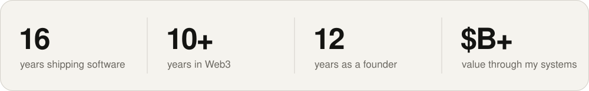
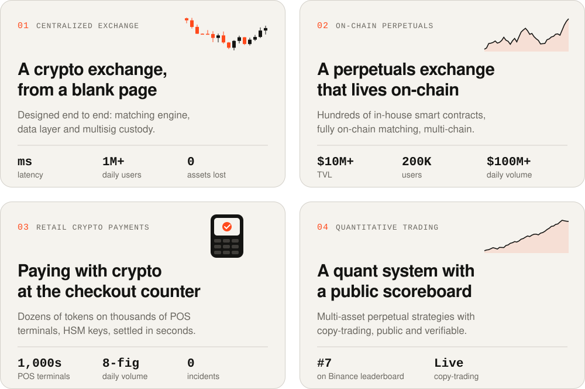
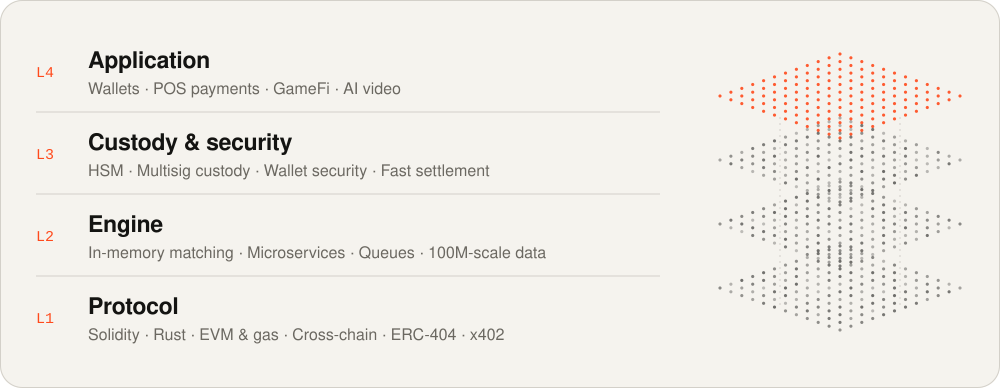

<a href="https://jean-roan-tau.vercel.app">
  <picture>
    <source media="(prefers-color-scheme: dark)" srcset="assets/hero-dark.svg">
    
  </picture>
</a>

  <a href="https://t.me/Jean0x"><picture><source media="(prefers-color-scheme: dark)" srcset="assets/btn-telegram-dark.svg"></picture></a>
  <a href="https://x.com/0x_jean_"><picture><source media="(prefers-color-scheme: dark)" srcset="assets/btn-x-dark.svg"></picture></a>
  <a href="https://jean-roan-tau.vercel.app"><picture><source media="(prefers-color-scheme: dark)" srcset="assets/btn-site-dark.svg"></picture></a>

Engineer and serial founder. I started writing production software in 2010, founded my first company in 2014, and went all-in on Web3 in 2017 — drawn less by the tokens than by the engineering problem: financial infrastructure where one bug can cost millions.

Since then I’ve designed and led a centralized exchange, an on-chain perpetuals exchange, a crypto payment network on thousands of point-of-sale terminals, and a quant trading system.

<picture>
  <source media="(prefers-color-scheme: dark)" srcset="assets/stats-dark.svg">
  
</picture>

### Things I’ve built

Names and links stay private at partners’ request — happy to walk through any of them over a call.

<a href="https://jean-roan-tau.vercel.app/#products">
  <picture>
    <source media="(prefers-color-scheme: dark)" srcset="assets/products-dark.svg">
    
  </picture>
</a>

<picture>
  <source media="(prefers-color-scheme: dark)" srcset="assets/bets-dark.svg">
  
</picture>

### Full stack, in the literal sense

<picture>
  <source media="(prefers-color-scheme: dark)" srcset="assets/stack-dark.svg">
  
</picture>

### Working together

**Technical partner** — building an exchange, derivatives venue or payment product? I join as technical co-founder or partner. 
**Second pair of eyes** — investors and teams weighing exchange, DeFi or payments tech get an honest read on what holds up. 
**Builder** — I assemble the team, set the architecture, and take the product from zero to an audited launch.

<b>繁體中文</b>

 

我是 Jean，工程師，也是連續創業者。2010 年開始寫生產級程式碼，2014 年創立第一家公司，2017 年全心投入 Web3——吸引我的不是代幣，而是工程難題：在這裡，一個 bug 可能損失數百萬。

從那以後，我設計並主導了一家中心化交易所、一個鏈上永續合約交易所、一個運行在全球數千台 POS 終端上的加密支付網路，以及一套量化交易系統。

- **技術合夥人**：正在打造交易所、衍生品平台或支付產品？我以技術聯合創始人或合夥人的身份加入。
- **第二雙眼睛**：投資人與團隊評估交易所、DeFi 或支付技術時，我會坦白告訴你哪些站得住。
- **親手打造**：組建團隊、確立架構，帶領產品從零走到通過審計的上線。

Telegram：[@Jean0x](https://t.me/Jean0x) · X：[@0x_jean_](https://x.com/0x_jean_) · 網站：[jean-roan-tau.vercel.app](https://jean-roan-tau.vercel.app/?lang=zh)

 

<picture>
  <source media="(prefers-color-scheme: dark)" srcset="assets/footer-dark.svg">
  
</picture>
