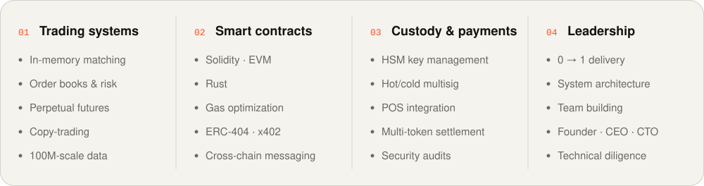
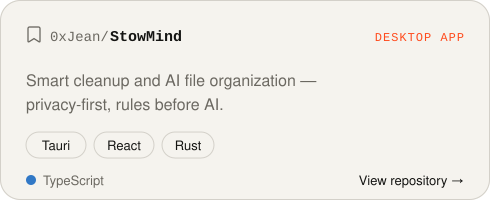
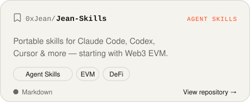
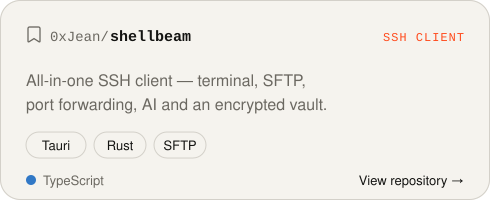
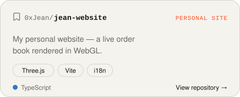

<picture>
  <source media="(prefers-color-scheme: dark)" srcset="assets/terminal-dark.svg">
  
</picture>

  <a href="https://t.me/Jean0x"><picture><source media="(prefers-color-scheme: dark)" srcset="assets/btn-telegram-dark.svg"></picture></a>
  <a href="https://x.com/0x_jean_"><picture><source media="(prefers-color-scheme: dark)" srcset="assets/btn-x-dark.svg"></picture></a>
  <a href="https://www.0xjean.com"><picture><source media="(prefers-color-scheme: dark)" srcset="assets/btn-site-dark.svg"></picture></a>

I build financial infrastructure for crypto — exchanges, on-chain derivatives, payment rails and trading systems — usually as founder, CEO or CTO. These days I also build AI-native developer tools and open-source the useful bits.

### Industries

<picture>
  <source media="(prefers-color-scheme: dark)" srcset="assets/industries-dark.svg">
  
</picture>

### Skills

<picture>
  <source media="(prefers-color-scheme: dark)" srcset="https://skillicons.dev/icons?i=solidity%2Crust%2Cts%2Cjs%2Cpython%2Creact%2Cnextjs%2Cnodejs%2Ctauri%2Cthreejs%2Ctailwind%2Cvite%2Cvercel%2Cgit&theme=dark&perline=14">
  
</picture>

  

<picture>
  <source media="(prefers-color-scheme: dark)" srcset="assets/expertise-dark.svg">
  
</picture>

### Open source

<a href="https://github.com/0xJean/StowMind"><picture><source media="(prefers-color-scheme: dark)" srcset="assets/repo-stowmind-dark.svg"></picture></a>&nbsp;<a href="https://github.com/0xJean/Jean-Skills"><picture><source media="(prefers-color-scheme: dark)" srcset="assets/repo-jean-skills-dark.svg"></picture></a>
<a href="https://github.com/0xJean/shellbeam"><picture><source media="(prefers-color-scheme: dark)" srcset="assets/repo-shellbeam-dark.svg"></picture></a>&nbsp;<a href="https://github.com/0xJean/jean-website"><picture><source media="(prefers-color-scheme: dark)" srcset="assets/repo-jean-website-dark.svg"></picture></a>

### Background

- **Centralized exchange** — in-memory matching engine, 100M-scale data, hot/cold multisig custody · 1M+ daily users · 0 assets lost
- **Perpetual DEX** — hundreds of in-house contracts, fully on-chain matching, multi-chain · $10M+ TVL · $100M+ daily volume
- **Crypto payment rail** — dozens of tokens on thousands of POS terminals, HSM-protected keys, settlement in seconds
- **Quant desk** — multi-asset perpetual strategies with copy-trading · #7 on the Binance leaderboard

Closed-source work; names stay private at partners’ request. The full story is on my <a href="https://www.0xjean.com">website</a>.

<b>繁體中文</b>

 

我是 Jean，Web3 架構師與連續創業者。過去多以創始人、CEO 或 CTO 的身份，打造加密世界的金融基礎設施——交易所、鏈上衍生品、支付通道與交易系統；現在也在做 AI 原生的開發者工具，並把有用的部分開源。

**行業**：中心化交易所 · 永續合約 DEX · 加密支付 · 量化交易 · DeFi · 託管與錢包安全 · GameFi · NFT · AI × Web3 · AI Agent 與開發工具

**開源專案**：[StowMind](https://github.com/0xJean/StowMind)（智能清理與 AI 檔案整理桌面應用）· [Jean-Skills](https://github.com/0xJean/Jean-Skills)（可攜式 Agent Skills，從 Web3 EVM 開發開始）· [shellbeam](https://github.com/0xJean/shellbeam)（一站式 SSH 客戶端）· [jean-website](https://github.com/0xJean/jean-website)（個人網站）

Telegram：[@Jean0x](https://t.me/Jean0x) · X：[@0x_jean_](https://x.com/0x_jean_) · 網站：[0xjean.com](https://www.0xjean.com/?lang=zh)

 

<picture>
  <source media="(prefers-color-scheme: dark)" srcset="assets/footer-dark.svg">
  
</picture>
